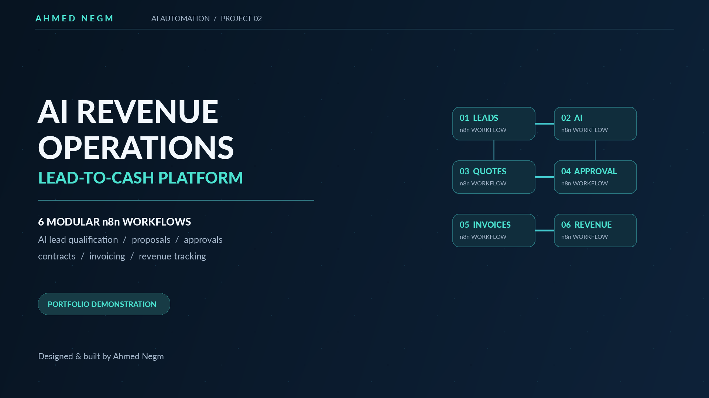
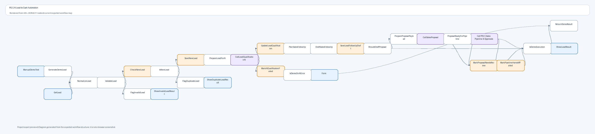

# P02 | AI Revenue Operations & Lead-to-Cash Automation

**An end-to-end, modular n8n portfolio demonstration by Ahmed Negm.**

[Watch the 67-second project demo](video_demo/P02_AI_Lead_to_Cash_Demo_1080p.mp4) | [Technical QA](docs/QA_REPORT.md) | [Install guide](docs/INSTALL_EN.md) | [Arabic guide](README_AR.md)

## The business problem

A business receives new leads, qualifies inquiries, writes proposals, requests approvals, prepares contract/invoice records, and tracks collections across disconnected systems. Repetitive handoffs introduce delays and missing context. This **fictional business scenario** is the basis of the demonstration.

## What the demo illustrates

1. **Lead intake & CRM:** n8n form, normalized fields, email deduplication, persistent CRM table, one-click synthetic lead demo.
2. **AI lead qualification:** Gemini primary, Groq fallback, validated JSON, score and priority; failed AI assessment is recorded.
3. **Proposal & quotation:** draft proposal, illustrative rate-card quote, Gemini/Groq failover, deterministic safe fallback and stored quote.
4. **Sales pipeline & approvals:** opportunity creation, authenticated human proposal decision, audit log, CRM stage updates.
5. **Contract & invoice drafting:** non-binding contract and draft invoice records, explicit finance reviewer release, no automated signatures.
6. **Payment ledger & revenue insights:** manual receipt records, duplicate/overpayment checks, ledger balance, aging and private internal dashboard.

## Demo media

The [project video](video_demo/P02_AI_Lead_to_Cash_Demo_1080p.mp4) is a **67-second, 1920 x 1080, 24-fps montage** created from source screenshots. [English captions](video_demo/P02_Demo_English_Captions.srt) are provided separately. Screenshots in `screenshots_original/` are the author's original editor screenshots **before the independent structural QA fixes**; the images in `workflow_diagrams_updated/` are generated from the corrected workflow JSON, not screenshots of live executions.

## Exported modules (6 workflows; 163 nodes)

| Export | Function |
| --- | --- |
| `P02_01_AI_Lead_Qualification_Engine.json` | Gemini -> Groq fallback |
| `P02_02_Sales_Proposal_and_Quotation.json` | AI/templated draft + quote table |
| `P02_03_AI_Lead_to_Cash_Automation.json` | Main orchestration + manual demo |
| `P02_04_Sales_Pipeline_and_Approvals_Final.json` | Human approvals + opportunity audit |
| `P02_05_Contract_and_Invoice_Automation.json` | Human-gated document records |
| `P02_06_Payment_Tracking_and_Revenue_Intelligence.json` | Manual payment ledger + revenue report |

The eight Data Table CSV schemas are in `data_tables/`. Remove the `SAMPLE_DELETE_ME` row after each import.

## Quality assurance: what has actually been verified?

- **39/39 test scenarios passed in a local JavaScript simulator** covering successful handoffs, provider failovers, rejection paths, retries, duplicate payments, and reporting.
- **157/157 executable workflow nodes were visited by the simulator** (the other 6 are three non-executing model dependencies and three sticky-note annotations).
- A separate static audit found **0 malformed references/CSV field mismatches/JavaScript syntax errors** across 163 nodes and 164 graph connections.
- **Not a live n8n test.** The simulator stubs Gemini/Groq and n8n node internals. It does not prove provider calls, webhook behavior, user permissions, or transactional/concurrent correctness on an n8n instance.

See [QA_REPORT.md](docs/QA_REPORT.md) for evidence and limitations. You can reproduce the mocked checks with Node.js 22+: `node tests/simulate_workflows.js`.

## Security & portability

This public archive removes credential bindings, installation-specific workflow IDs, original webhook IDs, and instance metadata. **After import, reconnect credentials, choose child workflows inside Execute Sub-workflow nodes, and verify all Data Table selectors.** See [INSTALL_EN.md](docs/INSTALL_EN.md).

This is a **portfolio/demo**, not a live financial, banking, contracting, or accounting product. Pricing is illustrative, signature evidence is human-declared, and receipts are manually recorded (not bank-reconciled). Production would need authentication/authorization validation, concurrency controls, provider costs, legal/tax review and live staging tests.

## Author

**Ahmed Negm** | AI Automation & n8n Workflows | Cairo, Egypt

This portfolio package intentionally does not assert real client business results or measured ROI.
